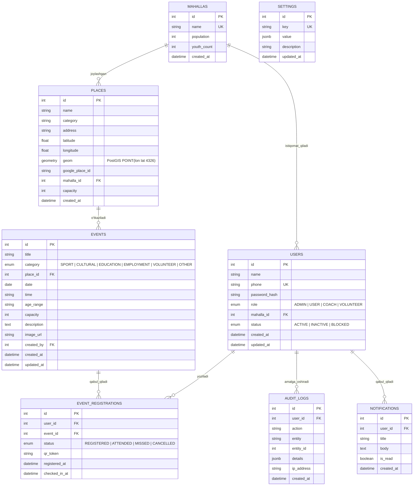

# Ma'lumotlar Bazasi Sxemasi (Database Schema)

Yunusobod Yoshlar Bandligi va Faolligi Platformasi ("Yunusobod — Birga") PostgreSQL va PostGIS asosida loyihalashtirilgan.

---

## 📐 ER Diagramma

---

## 🗄 Jadvallar va Ustunlar Tavsifi

### 1. `users` (Foydalanuvchilar)
Barcha adminlar, yoshlar, talabalar, volontyorlar va sportchilar shu jadvalda saqlanadi.
- `id` (SERIAL / INT, PK): Foydalanuvchi unikal identifikatori.
- `name` (VARCHAR(150)): To'liq ism-sharif (masalan: "Azizbek Karimov").
- `phone` (VARCHAR(20), UNIQUE): Telefon raqami (masalan: "+998 90 123 45 67"). Mobil kirishda SMS-kod shu raqamga boradi.
- `password_hash` (VARCHAR(255), NULLABLE): Admin kirishi uchun bcrypt xesh (oddiy mobil yoshlar OTP bilan kiradi).
- `role` (ENUM: `ADMIN`, `USER`, `COACH`, `VOLUNTEER`): Ruxsat darajasi.
- `mahalla_id` (INT, FK -> mahallas.id, NULLABLE): Istiqomat qiladigan mahallasi.
- `status` (ENUM: `ACTIVE`, `INACTIVE`, `BLOCKED`): Foydalanuvchining hozirgi holati.
- `created_at` (TIMESTAMP): Ro'yxatdan o'tgan sana.
- `updated_at` (TIMESTAMP): Oxirgi o'zgartirilgan sana.

### 2. `mahallas` (Mahallalar)
Yunusobod tumanidagi mahallalar (Tinchlik, Navbahor, Bodomzor, Yangi hayot, Oqtepa, Chinor, Bahor va h.k.).
- `id` (SERIAL, PK): Identifikator.
- `name` (VARCHAR(120), UNIQUE): Mahalla nomi.
- `population` (INT): Aholi soni.
- `youth_count` (INT): Yoshlar soni (14-30 yosh).
- `created_at` (TIMESTAMP).

### 3. `places` (Joylar va Obyektlar)
Tuman hududidagi 141 ta real joy: maktablar, stadionlar, masjidlar, bog'lar, madaniyat markazlari, kovorkinglar.
- `id` (SERIAL, PK): Identifikator.
- `name` (VARCHAR(200)): Obyekt nomi (masalan: "Tinchlik mahallasi sport maydoni").
- `category` (VARCHAR(60)): Toifa (Maktab, Stadion, Masjid, Madaniyat markazi, Bog', Kutubxona).
- `address` (VARCHAR(255)): Ko'cha va mo'ljal.
- `latitude` (DOUBLE PRECISION): Kenglik (41.3524).
- `longitude` (DOUBLE PRECISION): Uzunlik (69.2845).
- `geom` (GEOMETRY(Point, 4326)): PostGIS nuqta geometriyasi (radius bo'yicha masofani tezkor topish uchun).
- `google_place_id` (VARCHAR(100), NULLABLE): Google Places integratsiyasi uchun.
- `mahalla_id` (INT, FK -> mahallas.id): Qaysi mahallaga qarashliligi.
- `capacity` (INT): Joy sig'imi.

### 4. `events` (Tadbirlar)
Sport musobaqalari, konsertlar, treninglar, vakansiyalar yarmarkalari.
- `id` (SERIAL, PK): Identifikator.
- `title` (VARCHAR(255)): Tadbir nomi.
- `category` (ENUM: `SPORT`, `CULTURAL`, `EDUCATION`, `EMPLOYMENT`, `VOLUNTEER`, `OTHER`).
- `place_id` (INT, FK -> places.id): O'tkazilish joyi.
- `date` (DATE): O'tkazilish kuni (masalan: 2025-10-29).
- `time` (VARCHAR(10)): Boshlanish vaqti (masalan: "15:00").
- `age_range` (VARCHAR(50)): Yosh chegarasi (masalan: "15–25 yosh").
- `capacity` (INT): Qabul qilinadigan maksimal ishtirokchilar soni.
- `description` (TEXT): Tadbirning batafsil tavsifi.
- `image_url` (VARCHAR(500), NULLABLE): Tadbir afishasi / fotosurati.
- `created_by` (INT, FK -> users.id): Yaratgan mas'ul xodim / admin.

### 5. `event_registrations` (Ro'yxatdan o'tish va Davomat)
Foydalanuvchining tadbirga yozilishi va uning haqiqatda ishtirok etishi.
- `id` (SERIAL, PK): Identifikator.
- `user_id` (INT, FK -> users.id): Foydalanuvchi.
- `event_id` (INT, FK -> events.id): Tadbir.
- `status` (ENUM: `REGISTERED`, `ATTENDED`, `MISSED`, `CANCELLED`):
  - `REGISTERED`: Yozildi.
  - `ATTENDED`: Haqiqatda keldi (QR kod orqali yoki admin belgiladi).
  - `MISSED`: Yozildi, lekin kelmadi.
  - `CANCELLED`: Yozilishni o'zi bekor qildi.
- `qr_token` (VARCHAR(100), UNIQUE): Tadbirga kirishda skanerlanadigan shifrlangan QR token.
- `registered_at` (TIMESTAMP): Ro'yxatdan o'tgan payt.
- `checked_in_at` (TIMESTAMP, NULLABLE): QR orqali tasdiqlangan payt.

> **Kelish foizi hisoblash formulasi**:
> $$\text{Kelish foizi} = \left(\frac{\text{ATTENDED soni}}{\text{REGISTERED} + \text{ATTENDED} + \text{MISSED soni}}\right) \times 100\%$$

### 6. `settings` (Tizim sozlamalari)
Admin boshqaruv panelidagi dinamik konfiguratsiyalar.
- `id` (SERIAL, PK).
- `key` (VARCHAR(60), UNIQUE): Masalan `general_info`, `notifications`, `security`.
- `value` (JSONB): JSON qiymat (tuman nomi, email, telefon raqamlari, yoqilgan xabarlar).
- `updated_at` (TIMESTAMP).

### 7. `audit_logs` (Admin harakatlari jurnali)
Qaysi admin qachon qanday harakat bajarganini kuzatish.
- `id` (SERIAL, PK).
- `user_id` (INT, FK -> users.id).
- `action` (VARCHAR(100)): Masalan "BLOCK_USER", "CREATE_EVENT", "UPDATE_SETTINGS".
- `entity` (VARCHAR(50)): "User", "Event", "Setting".
- `entity_id` (INT, NULLABLE).
- `details` (JSONB).
- `ip_address` (VARCHAR(50)).
- `created_at` (TIMESTAMP).

---

## ⚡ Muhim Indekslar (Indexes)
- `CREATE INDEX idx_users_phone ON users(phone);`
- `CREATE INDEX idx_users_status_role ON users(status, role);`
- `CREATE INDEX idx_events_date ON events(date);`
- `CREATE INDEX idx_events_category ON events(category);`
- `CREATE INDEX idx_event_reg_event_user ON event_registrations(event_id, user_id);`
- `CREATE INDEX idx_event_reg_status ON event_registrations(status);`
- `CREATE INDEX idx_places_geom ON places USING GIST(geom);` (PostGIS geo-qidiruv)

